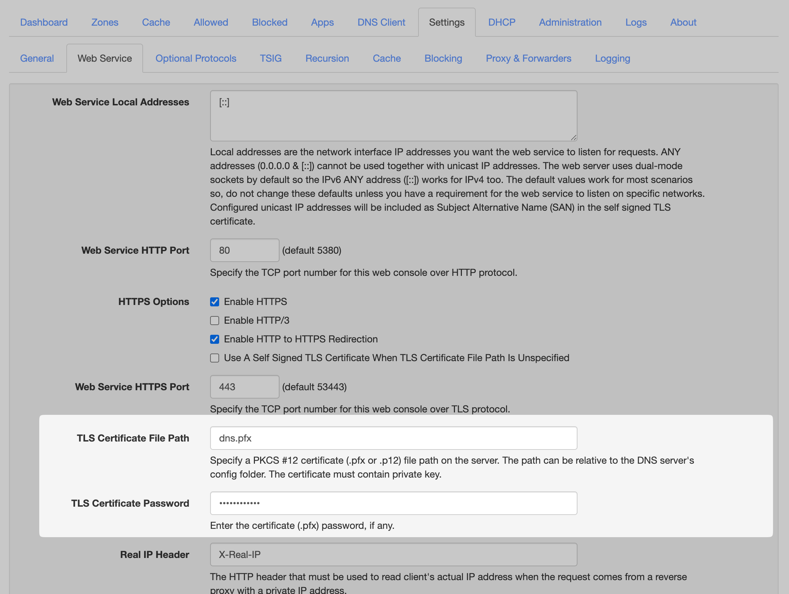

Are you using Technitium DNS and want to apply your own SSL certificate to the management interface? This guide will walk you through the process step by step.

## Certificate Format

> [!NOTE]
> If your certificate is in **CRT** and **KEY** format, you can convert it to PFX using **OpenSSL**.

```bash
openssl pkcs12 -export -out dns.pfx -inkey dns.key -in dns.crt
```

## Installing the Certificate

Place the certificate file (PFX format) in the config directory. You can find the correct location by checking the application logs.

Then, go to **Settings** → **Web Service**, and fill in the following:

- `TLS Certificate File Path`: Enter the filename of your certificate.
- `TLS Certificate Password`: Enter the password for the certificate.

Reload the web interface, and your custom SSL certificate should now be applied successfully!


