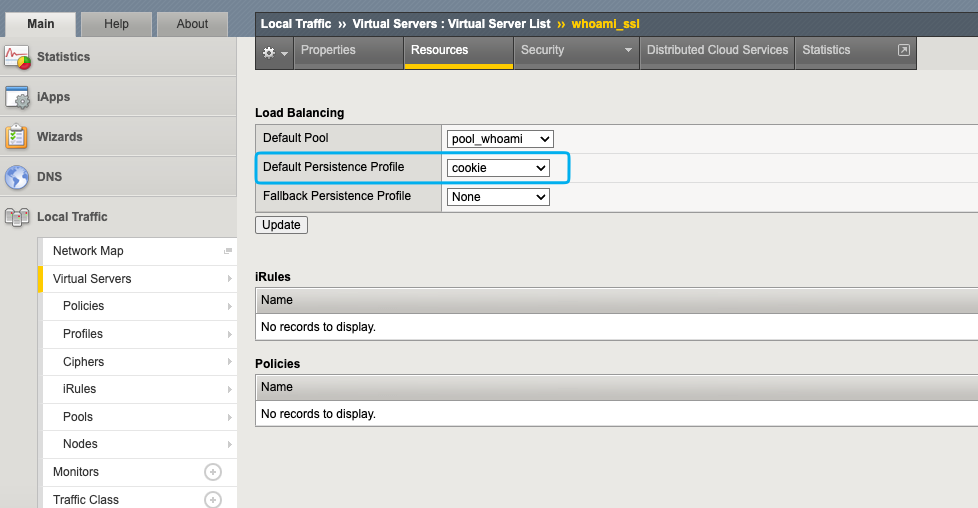
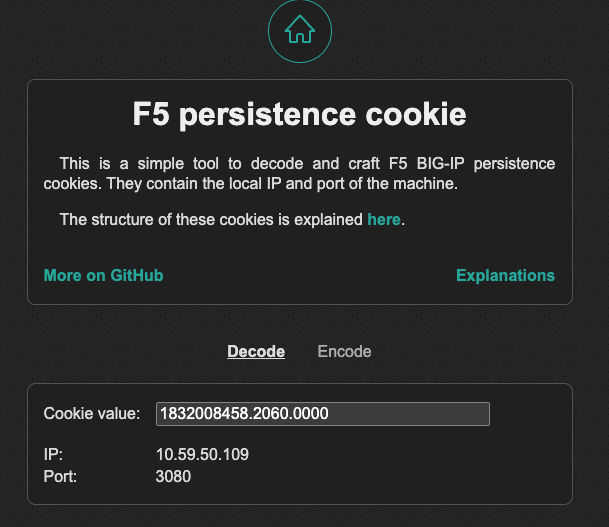
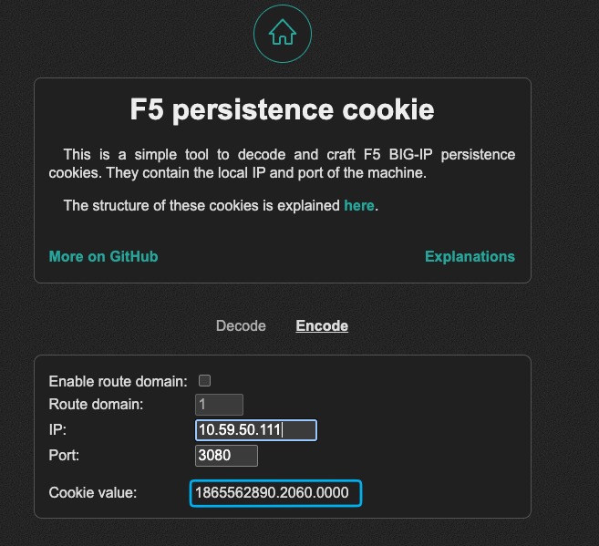
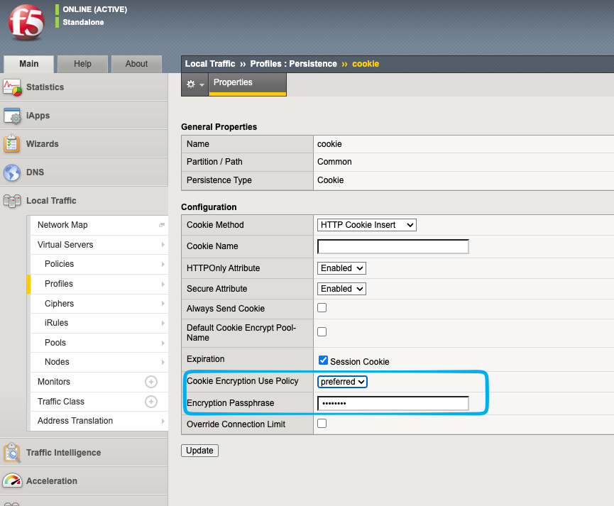

On F5 BIG-IP devices, the persistence cookie is a critical component used to maintain session state for users. However, if this cookie is not properly encrypted, it can lead to significant security vulnerabilities. In this blog post, we will explore the implications of unencrypted persistence cookies and how they can be exploited.

## The setup

I have a simple virtual server for `whoami.internal.remcokersten.nl` with a pool of two nodes. The virtual server is configured to use cookie-based persistence, which means that when a user connects to the virtual server, they are assigned a cookie that determines which backend node they will be directed to for subsequent requests.



## How persistence cookies work

When making a request to the virtual server without a persistence cookie, the nodes are rounded-robined. This means that the first request will go to one node, and the next request will go to the other node, and so on. See the example below:

```bash
➜  ~ curl https://whoami.internal.remcokersten.nl/
Hostname: 00e9fff946be

➜  ~ curl https://whoami.internal.remcokersten.nl/
Hostname: f0bc522b3947
```

When inspecting the response headers, we can see that the persistence cookie is set:

```bash mark={5}
➜  ~ curl https://whoami.internal.remcokersten.nl/ -I
HTTP/1.1 200 OK
Content-Length: 185
Content-Type: text/plain; charset=utf-8
Set-Cookie: BIGipServerpool_whoami=1832008458.2060.0000; path=/; Httponly; Secure
```

So when we make a request with the persistence cookie, we are always directed to the same node:

```bash
➜  ~ curl https://whoami.internal.remcokersten.nl/ -H "cookie: BIGipServerpool_whoami=1832008458.2060.0000"
Hostname: 00e9fff946be

➜  ~ curl https://whoami.internal.remcokersten.nl/ -H "cookie: BIGipServerpool_whoami=1832008458.2060.0000"
Hostname: 00e9fff946be

➜  ~ curl https://whoami.internal.remcokersten.nl/ -H "cookie: BIGipServerpool_whoami=1832008458.2060.0000"
Hostname: 00e9fff946be
```

## The problem with unencrypted cookies

The persistence cookie is not encrypted, which means that anyone who can intercept the cookie can potentially manipulate it to get directed to a different backend node. Let's decrypt the cookie with the [F5 persistence cookie](https://piellardj.github.io/f5-persistence-cookie/) tool:



As we can see, the decrypted cookie reveals the IP address of the backend node. IP `10.59.50.109` corresponds to the node `00e9fff946be`, as shown in the previous curl command. Let's change the IP address in the cookie to `10.59.50.111`, which corresponds to the other node `f0bc522b3947`. After modifying the cookie, we can make a request with the new cookie:



```bash
➜  ~ curl https://whoami.internal.remcokersten.nl/ -H "cookie: BIGipServerpool_whoami=1865562890.2060.0000"
Hostname: f0bc522b3947
```

As we can see, we are now directed to the other backend node. This demonstrates that by manipulating the unencrypted persistence cookie, an attacker can control which backend node they are directed to, potentially bypassing security controls or accessing sensitive information.

## How to mitigate this vulnerability

Go to the **persistence cookie profile** and change the "Cookie Encryption Use Policy" option to preferred or required.

> [!WARNING]
> The required option will break existing sessions by requiring all new sessions to use encrypted cookies, so it is recommended to use the preferred option first so that existing sessions can continue to use unencrypted cookies until they expire. After that, you can switch to the required option to enforce encryption for all new sessions.



When now making a request to the virtual server, we can see that the persistence cookie is now encrypted:

```bash mark={5}
➜  ~ curl https://whoami.internal.remcokersten.nl/ -I
HTTP/1.1 200 OK
Content-Length: 185
Content-Type: text/plain; charset=utf-8
Set-Cookie: BIGipServerpool_whoami=!cQPosY8P3qozLeWmO9qbotcTpd/ZFOLHWMCmVhV3u9iXmwkQXZ3kaipjKOGB8XUNKdDkKA3DyjuYxA==; path=/; Httponly; Secure
```
