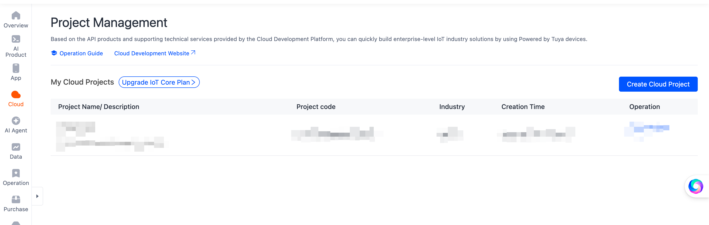
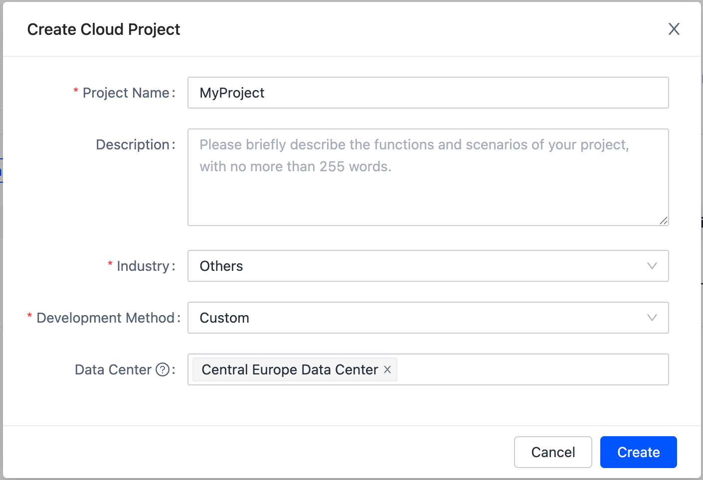
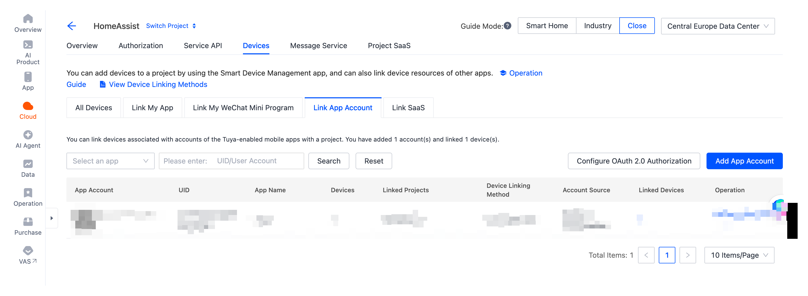
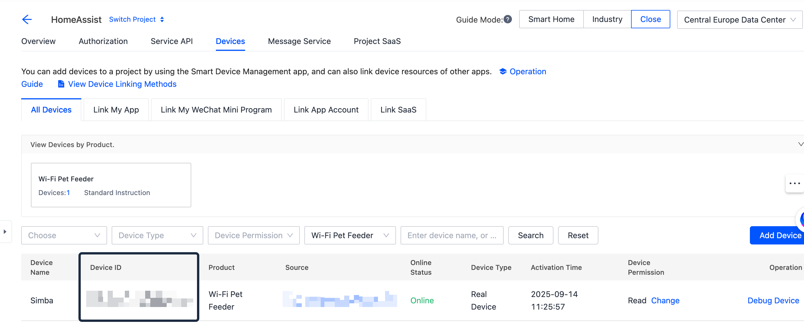
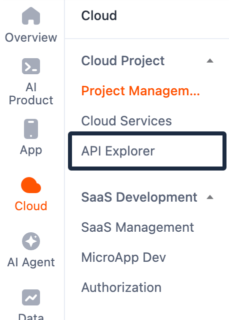
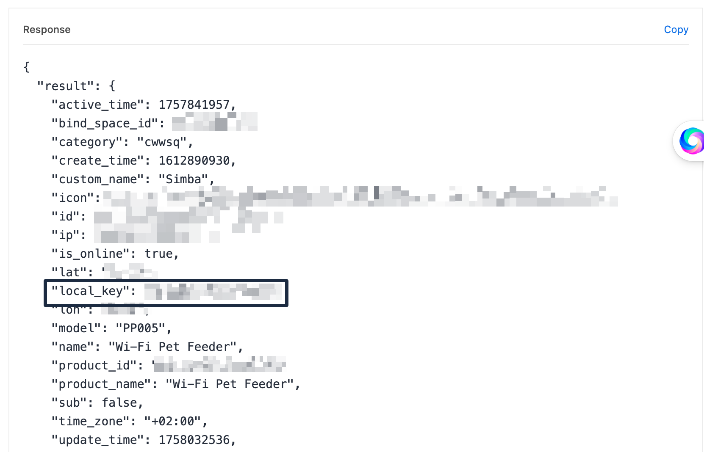

If you use **Home Assistant** and want to connect your **Tuya-managed IoT devices**, you’ll need the **Local Key** for each device. While retrieving it involves a few steps, it’s straightforward once you know the process. Here’s a step-by-step guide.

> [!NOTE]
> Before anything else, make sure your device is paired with the **Tuya Smart App**.
> Download the app ([iOS](https://apps.apple.com/nl/app/tuya-smart-life-smart-living/id1034649547) | [Android](https://play.google.com/store/apps/details?id=com.tuya.smart)) and follow the instructions to **add your device**.

## Create a Tuya Developer Account

You’ll need a **Tuya Developer account**, so go to the [Tuya Developer Platform](https://platform.tuya.com/) and create an account.

When you’re logged in, navigate to **Cloud > Project Management** and create a **new project**.

## Link Your Tuya App Account to Developer Account

To access your devices in the developer portal, you need to connect your regular Tuya account:

- Open the project you created in the previous step.
- Go to **Devices > Link App Account**.
- Click **Add App Account**.
- Follow the instructions to link your account.

Once linked, your devices will show up in the developer portal.

## Retrieve the Device’s Local Key

Now you can find the Local Key for your device.

Go to **Cloud > Devices > All Devices** and note the **Device ID**.

Navigate to **Cloud > API Explorer**.

Select **Device Management > Query Device Details** and enter the **Device ID**.

In the output, you will see the **Local Key**.

## Conclusion

That’s it! With the **Local Key**, you can now integrate your Tuya devices into **Home Assistant** and control them locally.
