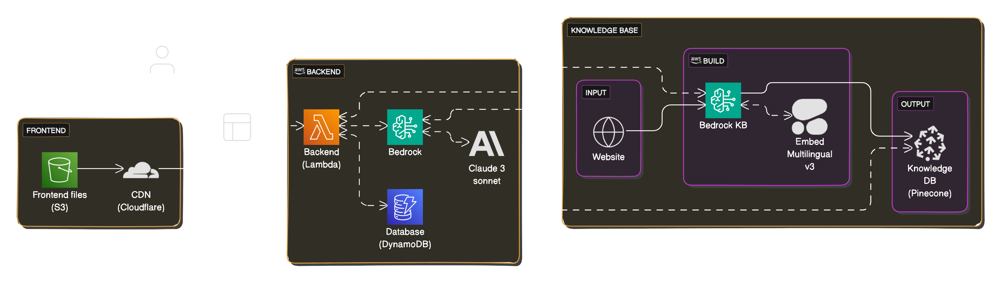

In recent months, the quality and use of AI have grown quick. At first, I found this development a bit intimidating because I felt like I had no control over how LLMs generate responses. However, my view has completely changed.

About a year ago, I discovered the power of prompt engineering. This means asking questions in a way that makes an LLM respond exactly how you want it to. But my knowledge of AI didn't go much further than that.

During a recent talk at [DevOpsdays 2024](https://devopsdays.org/events/2024-amsterdam/welcome/) in Amsterdam, [John Willis](https://twitter.com/botchagalupe) and [Patrick Debois](https://twitter.com/patrickdebois) introduced me to a fast-growing technique called Retrieval-Augmented Generation (RAG). This concept is actually quite simple: you provide the information you want to use as context, along with the question, to the LLM. A good example is an IT helpdesk: a standard LLM like ChatGPT can't directly answer user questions because it's not specifically trained with that helpdesk's information. If it can answer questions, those answers are based on general knowledge, not on the specific context of the helpdesk.

Instead of training a completely new model, RAG offers a great solution. With RAG, relevant information is stored in a knowledge base. When a user asks a question, the relevant information is pulled from the knowledge base and given to the LLM along with the question.

## Dentibot

To put this technique into practice, I created a chatbot experiment called Dentibot. This chatbot is designed to explain dental invoices and answer related questions. The information Dentibot uses are based on the official tariff codes and explanations for 2024, stored in a vector database (Pinecone). Thanks to this setup, Dentibot can retrieve the relevant information from the vector database when a user asks a question. The LLM model I used is [Anthropic Claude](https://www.anthropic.com/claude), which is great at generating answers in a specific format. This is important because the answers sometimes need further processing in the backend.

> [!NOTE]
> Please note that this is a Dutch-language chatbot.

## How It Works

Here's how the chatbot works:

\- The user uploads an invoice.

\- The backend sends the image to Claude to check if it is an invoice.

\- Claude then reanalyzes the invoice to read the lines on it.

\- The backend sends the lines to Claude again, asking if it's a dental invoice.

\- The user sees the extracted invoice lines and confirms if they are correct.

\- The backend searches for relevant information in the vector database and sends this, along with the invoice lines, to Claude to generate an explanation for each line.

\- The output generated by Claude is embedded into the website using a multilingual embedding technique (Embed Multilingual v3) and also stored in a separate Knowledge DB (Pinecone) for future reference or analysis.

\- The user can then ask questions about the invoice.

\- The backend retrieves relevant information about the question from the vector database and Knowledge DB, and sends this, along with the previously generated information, to Claude to answer the question.

## Fully Serverless

This project runs entirely on serverless services provided by AWS. The following components are used:

- **S3** for hosting the frontend
- **Lambda** for executing the backend (written in Python)
- **DynamoDB** for storing chat history
- **Bedrock and Pinecone** for performing searches on the knowledge base and storing the generated output
- **Bedrock and Anthropic Claude** as the LLM model

## Conclusion

This project shows how combining LLMs with modern techniques like RAG allows us to "easy" create context-specific tasks without needing to train a completely new model. Also, AWS's serverless services make it easy to quickly launch such projects without requiring extensive infrastructure.
